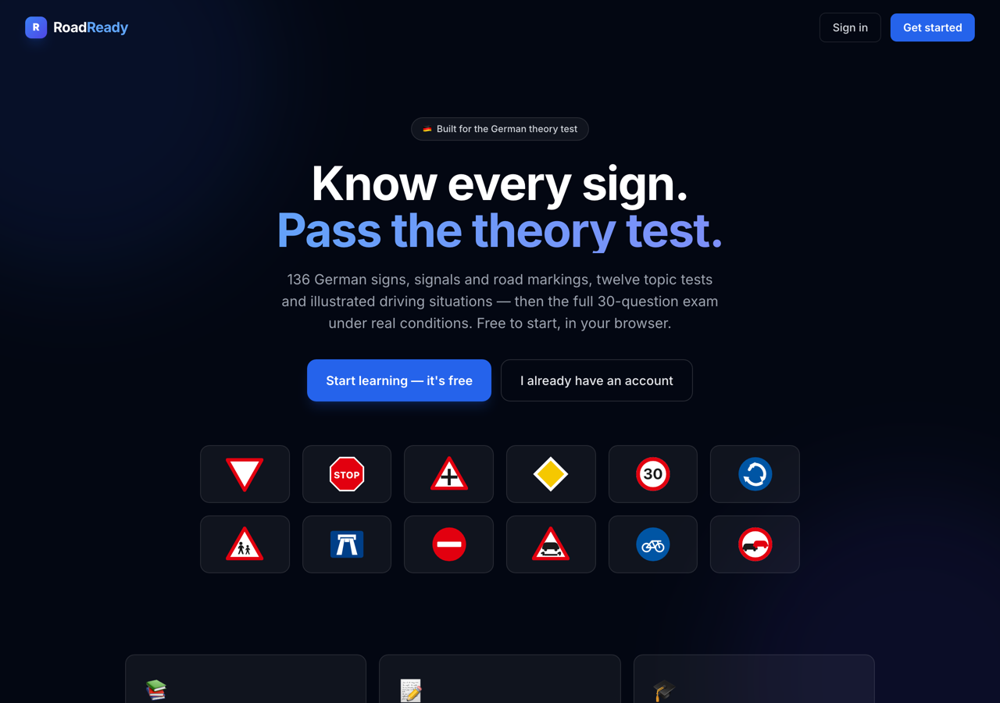
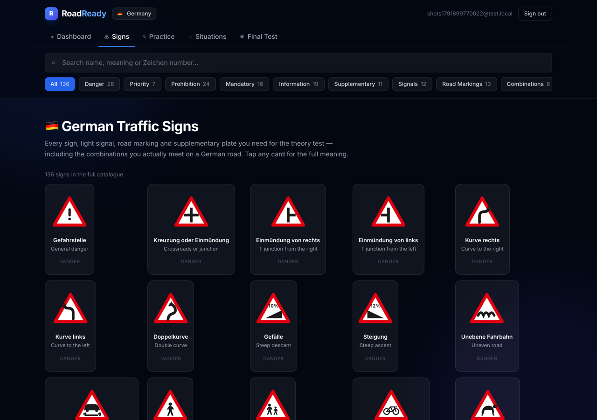
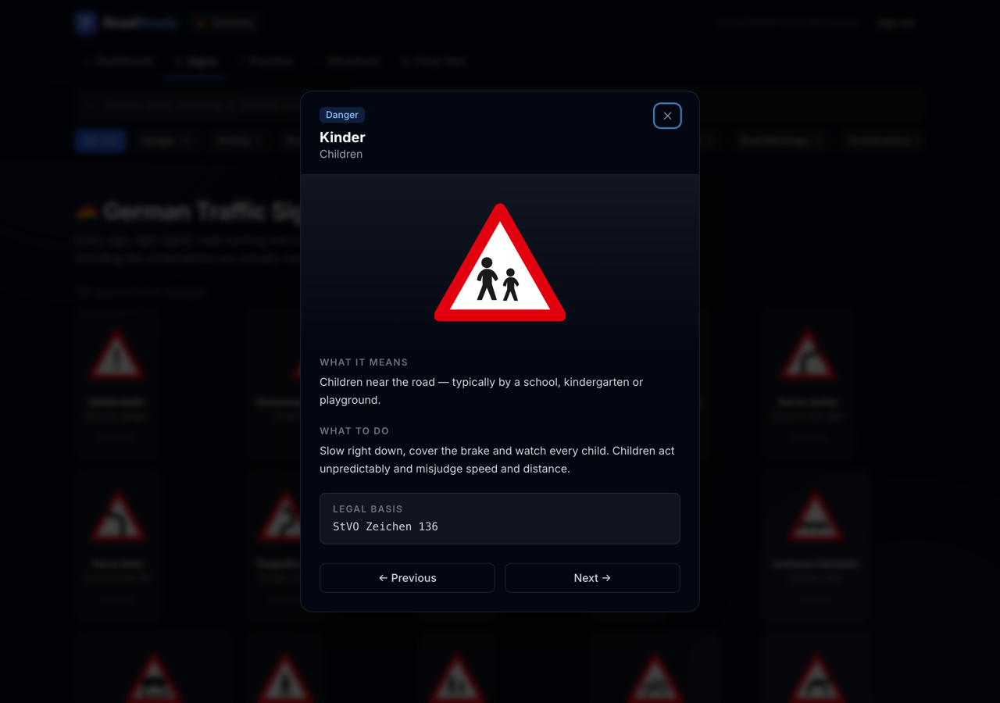
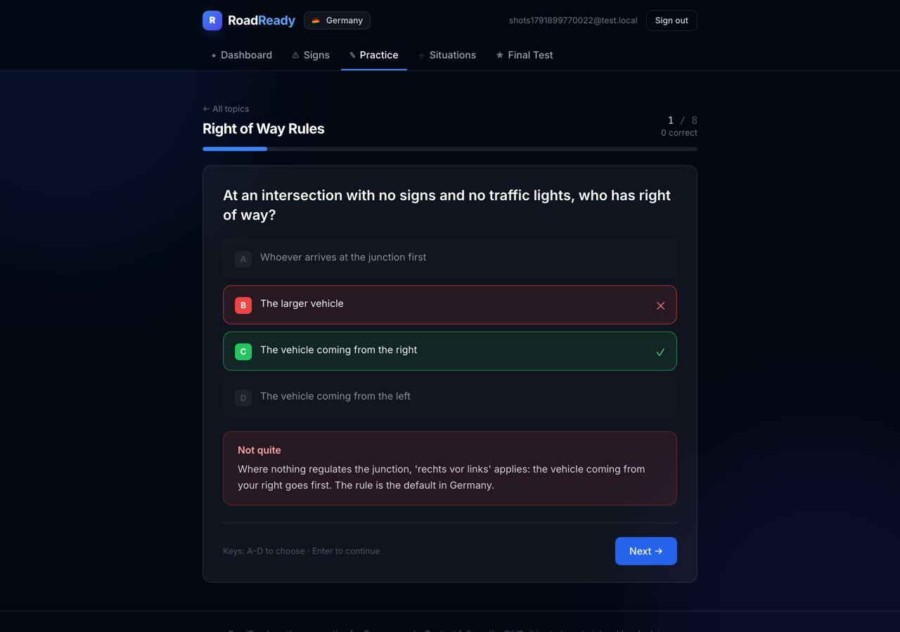
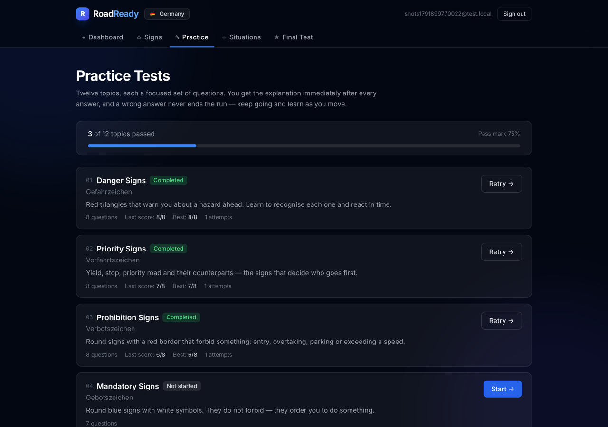
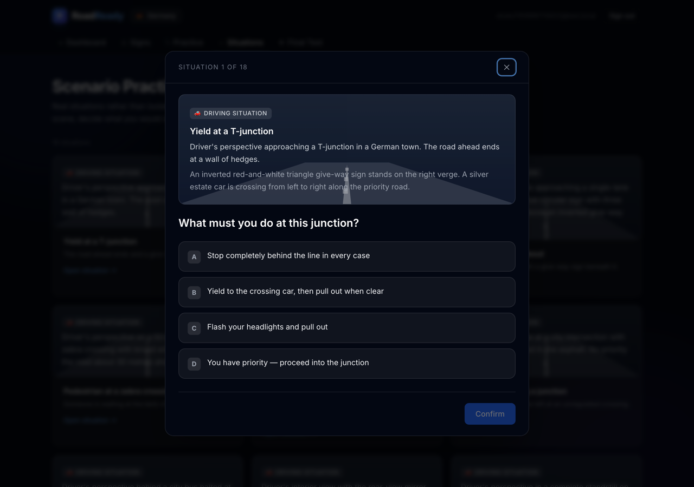
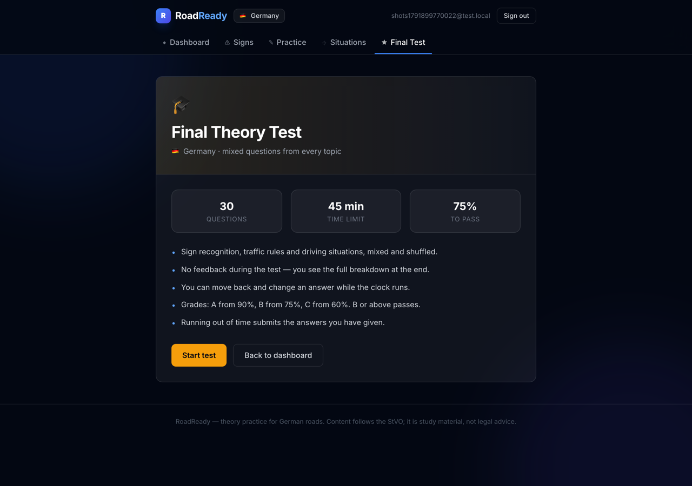
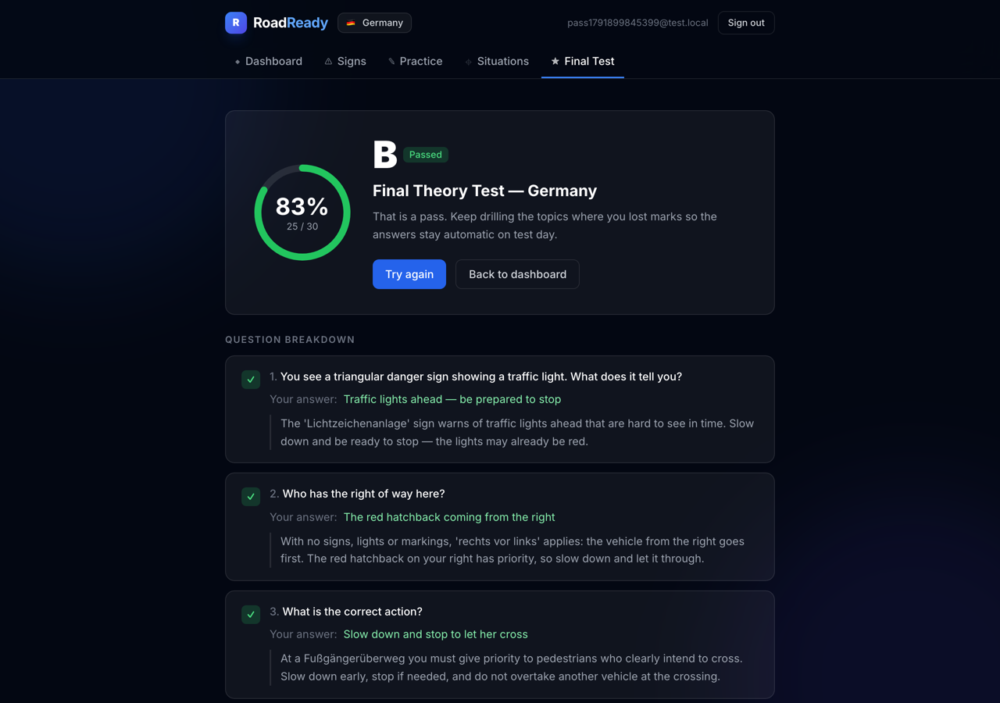
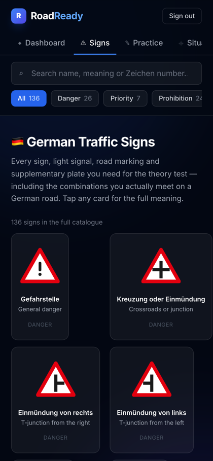

# 🚗 RoadReady

### Know every sign. Pass the theory test.

**A free, browser-based way to learn the German driving theory test — the complete sign catalogue, topic-by-topic practice, and a full timed exam.**

---

## What is RoadReady?

Getting a German driving licence costs €2,000–€4,000, and the theory test is the
first hurdle. Most apps just drill the official question catalogue at you.
RoadReady teaches the **rule behind the answer** first.

You learn the signs, drill each topic until the answers are automatic, then sit a
full 30-question exam under real conditions — all in the browser, nothing to
install.

**It's built for** people learning to drive in Germany, and especially for
immigrants, expats and students doing it in a second language.

> Germany is complete today. France is being written.

---

## ✨ What you can do

### 📚 Browse the complete sign catalogue

Every German traffic sign, light signal, road marking and supplementary plate —
**136 in total**, each with its German and English name, what it means, what you
must actually do, and the StVO article it comes from.

Search by name, meaning or Zeichen number, filter by category, and tap any sign
for the full explanation.

---

### 📝 Practice by topic

Twelve focused topics, from _Rechts vor Links_ to Autobahn rules. You get the
explanation **after every answer**, and a wrong answer never ends the run — you
keep going and keep learning.

Your best score, last score and attempt count are tracked per topic.

---

### 🎬 Work through real situations

Eighteen illustrated driving situations — a T-junction with a give-way sign, a
tram crossing, a jam on the Autobahn, fog on a country road. These test
judgement, not just whether you can name a sign.

---

### 🎓 Sit the full theory test

30 mixed questions, 45 minutes on the clock, no feedback until you finish —
exactly like the real thing.

Afterwards you get a grade, a score, and a per-question breakdown showing what
you answered, what was right, and why.

| Grade | Score |
| ----- | ----- |
| **A** | 90%+  |
| **B** | 75%+  |
| **C** | 60%+  |
| **F** | below |

You pass at **75%** — grade B or better.

---

### 📱 Works on your phone

---

## 📦 What's inside

| Content                          | Count                              |
| -------------------------------- | ---------------------------------- |
| Traffic signs, signals, markings | 136                                |
| Topic tests                      | 12                                 |
| Practice questions               | 105                                |
| Illustrated driving situations   | 18                                 |
| Countries                        | 🇩🇪 Germany (🇫🇷 France in progress) |

Every sign is **drawn in code** as a vector graphic — nothing is a photo or a
stock image, so they stay crisp at any size and load instantly.

<b>The sign library in detail</b>

| Category                                | Count |
| --------------------------------------- | ----- |
| ⚠️ Danger signs (Gefahrzeichen)         | 27    |
| 🔺 Priority signs (Vorfahrtzeichen)     | 8     |
| ⛔ Prohibition signs (Verbotszeichen)   | 24    |
| 🔵 Mandatory signs (Vorschriftzeichen)  | 16    |
| ℹ️ Information signs (Richtzeichen)     | 19    |
| 🏷️ Supplementary plates (Zusatzzeichen) | 11    |
| 🚦 Light signals (Lichtzeichen)         | 12    |
| 🛣️ Road markings                        | 13    |
| 🔗 Sign + plate combinations            | 8     |

The combinations matter: a 30 limit means something different with a _bei Nässe_
plate under it, and a priority road that bends is the single most misread sign
pairing on German roads.

<b>The twelve topics</b>

1. Gefahrzeichen — Danger Signs
2. Vorfahrtszeichen — Priority Signs
3. Verbotszeichen — Prohibition Signs
4. Gebotszeichen — Mandatory Signs
5. Richtzeichen — Information Signs
6. Vorfahrtsregeln — Right of Way Rules
7. Geschwindigkeit und Abstand — Speed Limits & Distances
8. Lichtzeichen und Signale — Traffic Lights & Signals
9. Autobahnregeln — Motorway Rules
10. Fußgänger und Radfahrer — Pedestrians & Cyclists
11. Notfälle und besondere Situationen — Emergency & Special Situations
12. Parken und Halten — Parking & Stopping Rules

---

## 🗺️ Roadmap

- [x] Complete German sign catalogue
- [x] Twelve topic tests with explanations
- [x] Illustrated driving situations
- [x] Timed, graded theory exam
- [ ] Deeper question banks (15–20 per topic)
- [ ] Sign-recognition mode — see the sign, name the rule
- [ ] Review queue for the questions you keep missing
- [ ] 🇫🇷 France, then more of Europe
- [ ] German, Turkish and Arabic interface

---

## 🚀 Getting started

Just open **[roadready.online](https://roadready.online)**, create a free
account and pick your country.

Want to run it yourself or contribute? See the
**[Developer Guide](./DEVELOPER_GUIDE.md)**.

---

## 🤝 Contributing

Corrections to the content are especially welcome — if a question, explanation
or sign is wrong or out of date, please
[open an issue](https://github.com/Vasu021/roadready.online/issues). Include the
StVO reference where you can.

Setup, project structure and conventions are in the
[Developer Guide](./DEVELOPER_GUIDE.md).

---

## 📄 License

MIT — see [LICENSE](./LICENSE).

> **Disclaimer:** RoadReady is independent study material based on the German
> StVO. It is not affiliated with TÜV, DEKRA or any licensing authority, and it
> is not legal advice. Always check the current official rules.
