

# 🚗 RoadReady

### Learn the rules. Know every sign. Pass the theory test.

**A free, browser-based course for the German driving theory test — the official
14-module curriculum, the complete sign catalogue, illustrated driving
situations, and a graded exam. In 13 languages, with six themes and audio.**

---

## What is RoadReady?

Getting a German driving licence costs €2,000–€4,000, and the theory test is the
first hurdle. Most apps just drill the official question catalogue at you.
RoadReady **teaches the rule first**, then tests you on it.

The course follows the curriculum German driving schools are legally required to
teach — the twelve _Grundstoff_ lessons and two class-B _Zusatzstoff_ lessons of
the [FahrschAusbO](https://www.gesetze-im-internet.de/fahrschausbo_2012/FahrschAusbO_2012.pdf) —
so finishing it means you have covered what the law says you must learn.

**Built for** people learning to drive in Germany, and especially for immigrants,
expats and students doing it in a second language.

> Germany is complete. France is next.

---

## ✨ What you can do

### 📘 Learn the official curriculum

Fourteen modules, 92 lessons. Each lesson is one screen: an explanation, an
illustration where it helps, the signs involved, and a _remember this_ box.
Your progress is tracked per lesson, and each module ends with its own quiz.

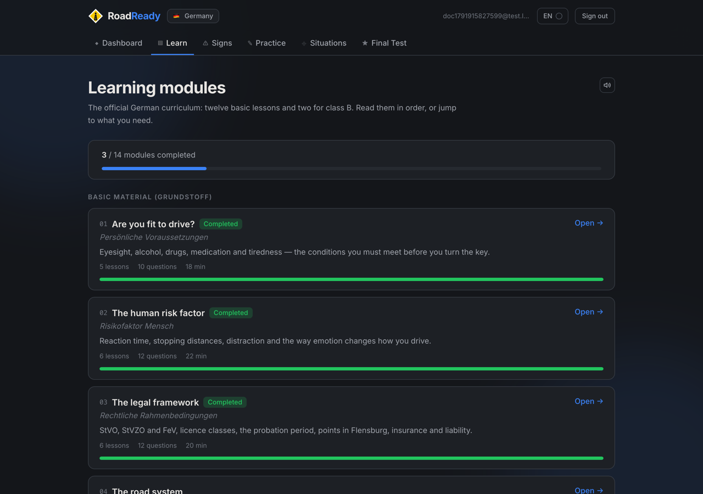

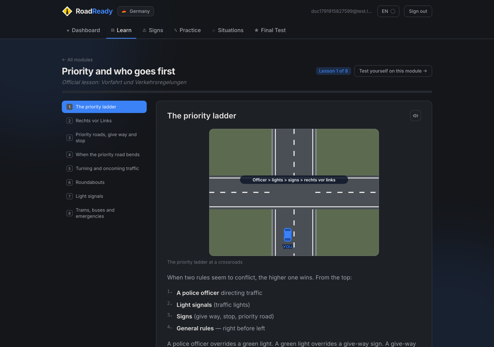

Lessons pull in the real sign components, so you learn the rule and the sign
together.

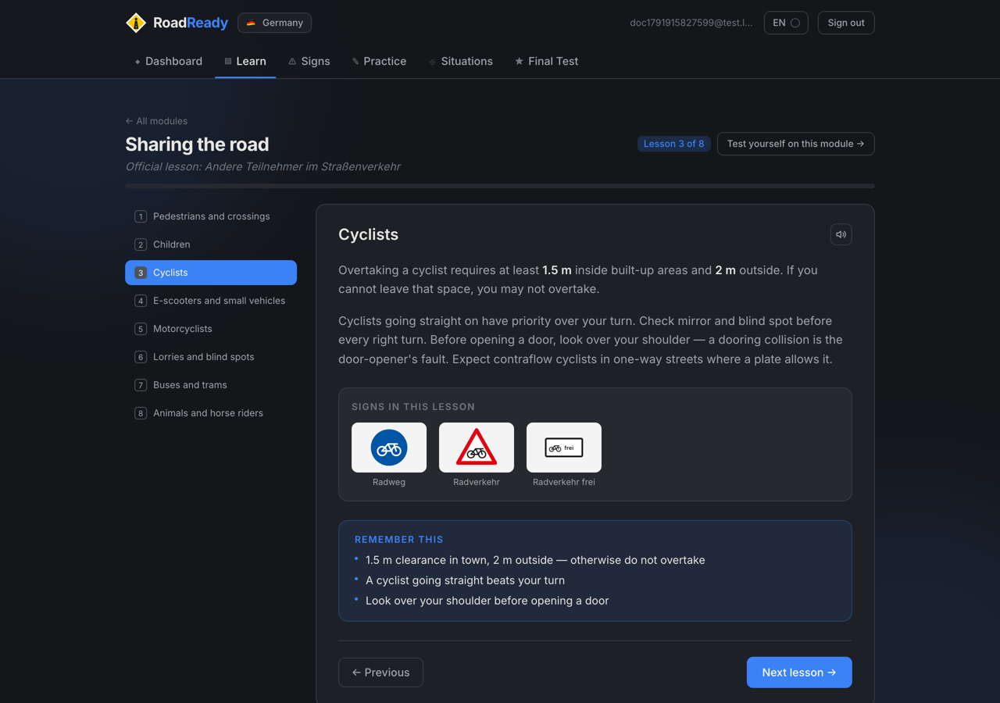

---

### 📚 The complete sign catalogue

136 German signs, light signals, road markings and supplementary plates — each
with its German and English name, what it means, what you must actually do, and
the StVO article it comes from. Every one is drawn in code, so they stay crisp
at any size.

---

### 📝 Practice until it's automatic

Topic-by-topic question sets with an explanation after **every** answer. A wrong
answer never ends the run — you keep going and keep learning.

---

### 🎬 Work through real situations

Driving situations drawn as diagrams rather than described in a paragraph: a
junction, a crossing, a tram, fog on a country road. Each scene is generated
from data, so it restyles with your theme and stays accurate.

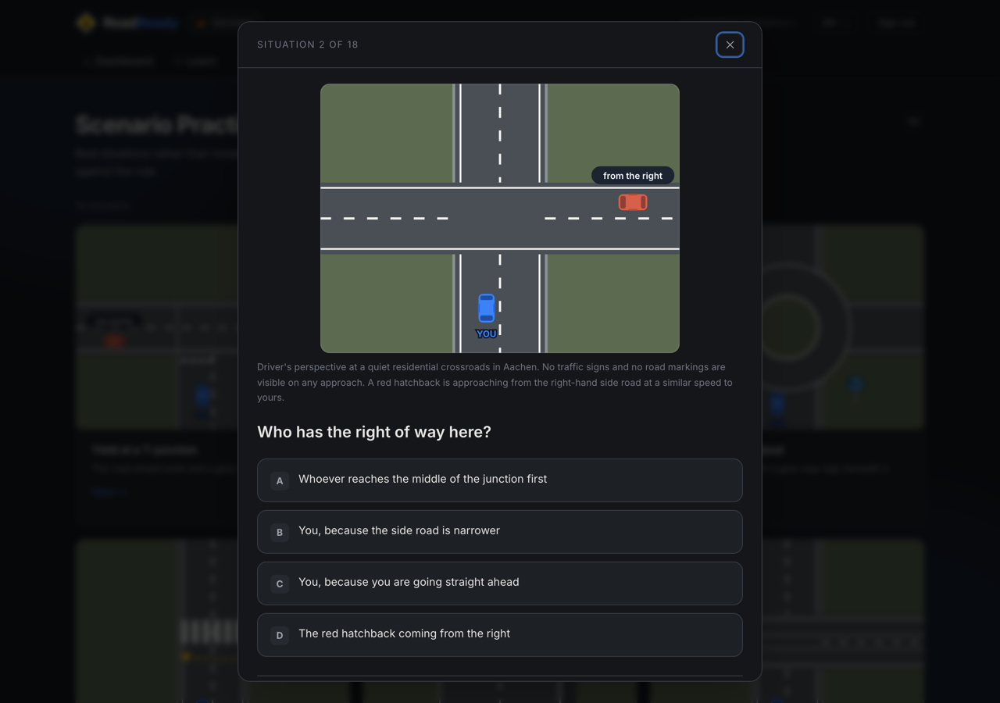

---

### 🎓 Sit the real exam

30 questions — 20 from the basic material and 10 from the class-B supplement,
exactly as the official exam splits them. Questions are weighted **2 to 5 error
points**; you may collect at most **10**, and getting two 5-point questions
wrong fails you on its own.

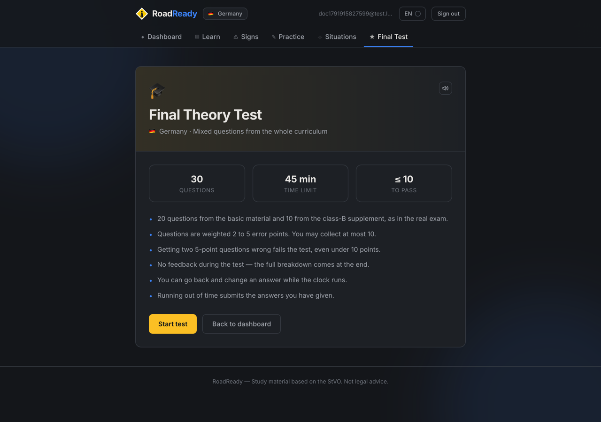

Afterwards you get a grade, your error-point total, and a per-question breakdown
showing what you answered, what was right, what it cost, and why.

---

### 🌍 In your language

All **13 languages the official exam is offered in**: German, English, Turkish,
Arabic, Russian, Romanian, Polish, French, Italian, Spanish, Portuguese,
Croatian and Greek. Arabic switches the whole interface to right-to-left.

German traffic terms stay German everywhere — _Vorfahrt gewähren_,
_Rettungsgasse_, _Zusatzzeichen_ — because those are the words on the sign and
in the exam.

<table>
<tr>
<td width="50%">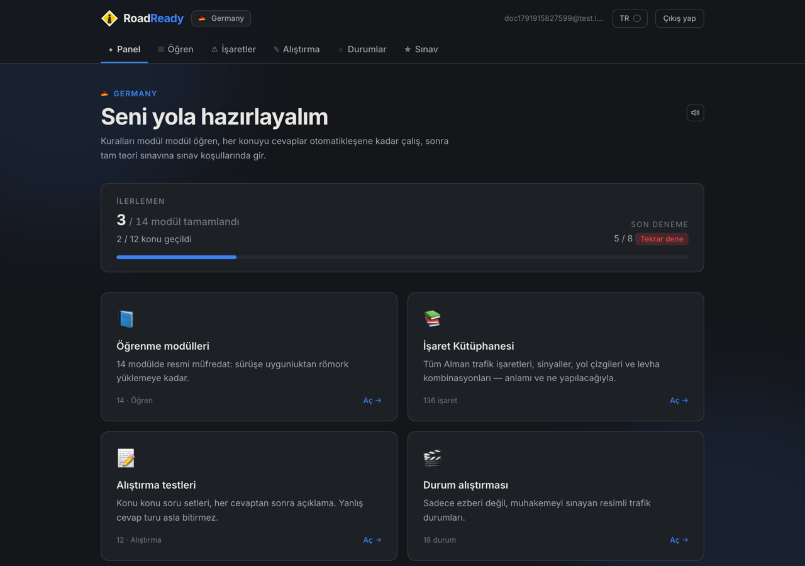</td>
<td width="50%">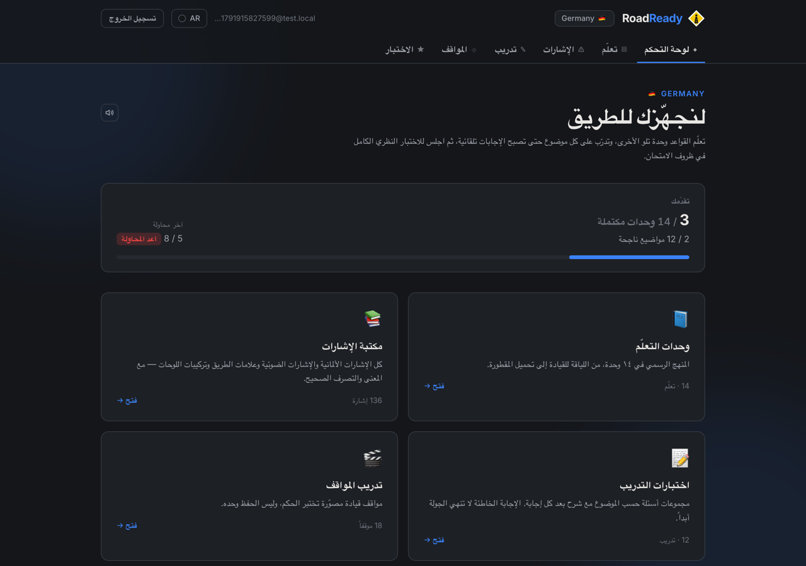</td>
</tr>
</table>

---

### 🔊 Listen to anything

A speaker button sits next to every lesson, question, explanation and sign.
It reads the text aloud in your language — and switches to a German voice for
German traffic terms mid-sentence, so _Vorfahrt gewähren_ sounds right instead
of being mangled.

---

### 🎨 Six themes

Long study sessions are hard on the eyes, so pick the surface you like: the
default dark **Study** theme, a warm **Wood** desk, a **Green board** or
**Blackboard** with chalk, bright **Daylight**, or **High contrast** for low
vision.

<table>
<tr>
<td width="50%">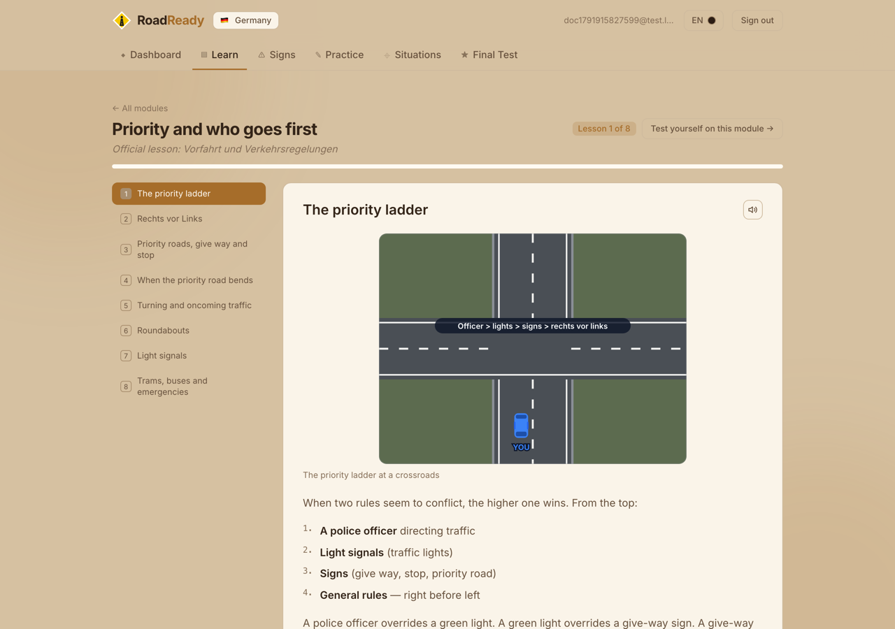</td>
<td width="50%">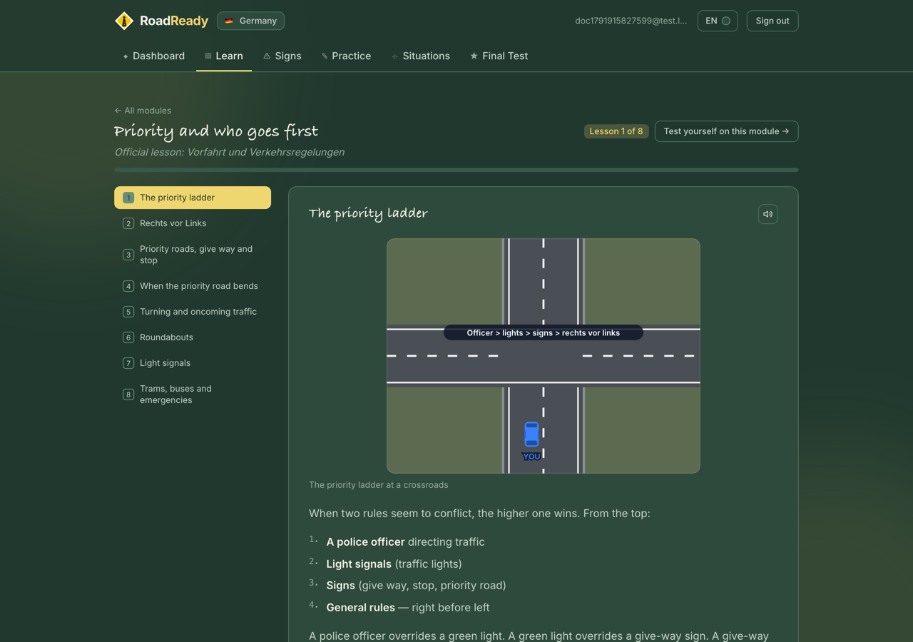</td>
</tr>
<tr>
<td width="50%">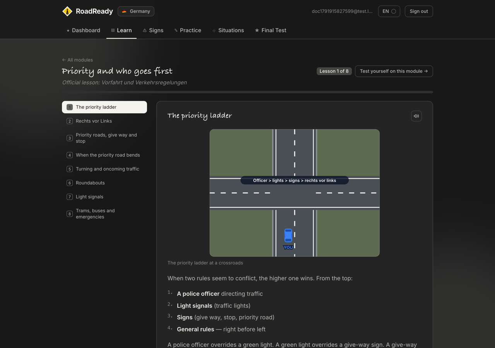</td>
<td width="50%">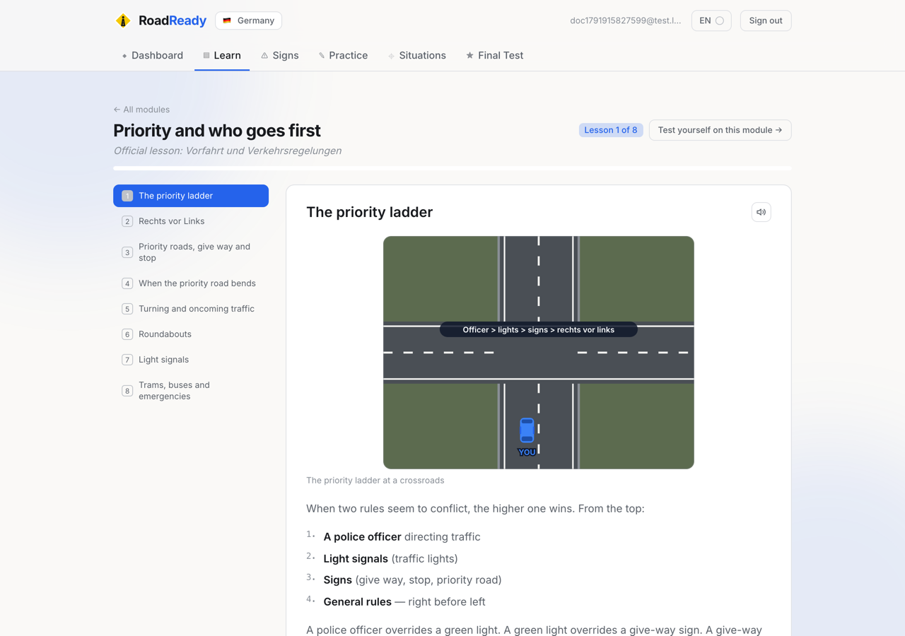</td>
</tr>
</table>

Traffic signs never change colour with the theme — they are legally defined, and
you need to memorise them exactly as they are.

---

### 📱 Works on your phone

---

## 📦 What's inside

| Content                                | Count |
| -------------------------------------- | ----- |
| Learning modules (official curriculum) | 14    |
| Lessons                                | 92    |
| Questions                              | 289   |
| Signs, signals and road markings       | 136   |
| Illustrated driving situations         | 18    |
| Languages                              | 13    |
| Themes                                 | 6     |

<b>The 14 modules</b>

**Grundstoff — the basic material (12 lessons)**

1. Persönliche Voraussetzungen — are you fit to drive?
2. Risikofaktor Mensch — reaction time, distances, distraction
3. Rechtliche Rahmenbedingungen — StVO, licence classes, points in Flensburg
4. Straßenverkehrssystem und seine Nutzung — road types and zones
5. Vorfahrt und Verkehrsregelungen — priority and who goes first
6. Verkehrszeichen und Verkehrseinrichtungen — signs, markings, level crossings
7. Andere Teilnehmer im Straßenverkehr — pedestrians, cyclists, lorries, trams
8. Geschwindigkeit, Abstand, umweltschonende Fahrweise — speed and distance
9. Verkehrsverhalten bei Fahrmanövern — manoeuvres and observation
10. Ruhender Verkehr — stopping and parking
11. Verhalten in besonderen Situationen — emergencies and penalties
12. Lebenslanges Lernen — staying a good driver

**Zusatzstoff — class B supplement (2 lessons)**

13. Technische Bedingungen, Personen- und Güterbeförderung — vehicle, loads, passengers
14. Fahren mit Solokraftfahrzeugen und Zügen — driving the car itself

<b>The sign catalogue</b>

| Category                                | Count |
| --------------------------------------- | ----- |
| ⚠️ Danger signs (Gefahrzeichen)         | 27    |
| 🔺 Priority signs (Vorfahrtzeichen)     | 8     |
| ⛔ Prohibition signs (Verbotszeichen)   | 24    |
| 🔵 Mandatory signs (Vorschriftzeichen)  | 16    |
| ℹ️ Information signs (Richtzeichen)     | 19    |
| 🏷️ Supplementary plates (Zusatzzeichen) | 11    |
| 🚦 Light signals (Lichtzeichen)         | 12    |
| 🛣️ Road markings                        | 13    |
| 🔗 Sign + plate combinations            | 8     |

---

## 🗺️ Roadmap

- [x] The official 14-module curriculum with 92 lessons
- [x] Complete German sign catalogue
- [x] Illustrated driving situations, generated from data
- [x] Official error-point exam scoring
- [x] 13 languages, including right-to-left
- [x] Six themes and read-aloud everywhere
- [ ] Deeper question banks, towards the official catalogue's depth
- [ ] More illustrated situations
- [ ] Sign-recognition mode — see the sign, name the rule
- [ ] Review queue for the questions you keep missing
- [ ] 🇫🇷 France, then more of Europe

---

## 🚀 Getting started

Open **[roadready.online](https://roadready.online)**, create a free account and
pick your country.

Want to run it yourself or contribute? See the
**[Developer Guide](./DEVELOPER_GUIDE.md)**.

---

## 🤝 Contributing

Corrections to the content are especially welcome — if a rule, explanation or
sign is wrong or out of date, please
[open an issue](https://github.com/Vasu021/roadready.online/issues) with the
StVO reference where you can. Translation improvements are welcome too: the
non-English content is machine-assisted and needs native review.

---

## 📄 License

MIT — see [LICENSE](./LICENSE).

> **Disclaimer:** RoadReady is independent study material based on the German
> StVO and the FahrschAusbO curriculum. It is not affiliated with TÜV, DEKRA or
> any licensing authority, and it is not legal advice. Always check the current
> official rules.
